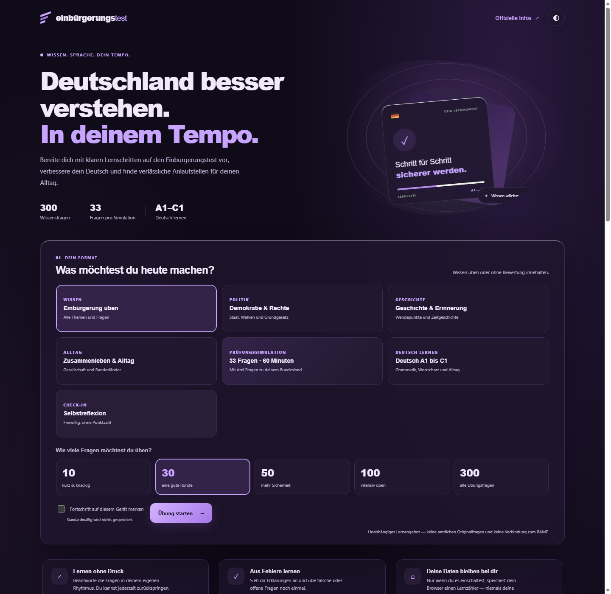
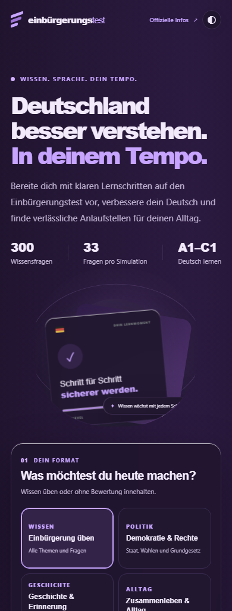
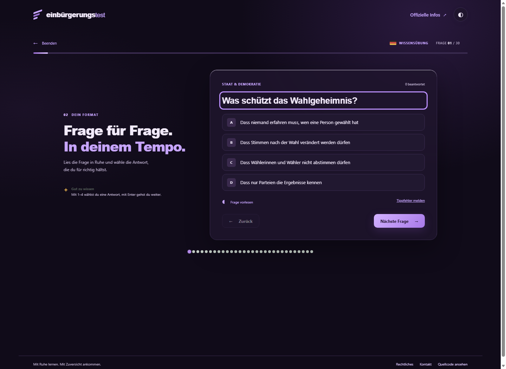
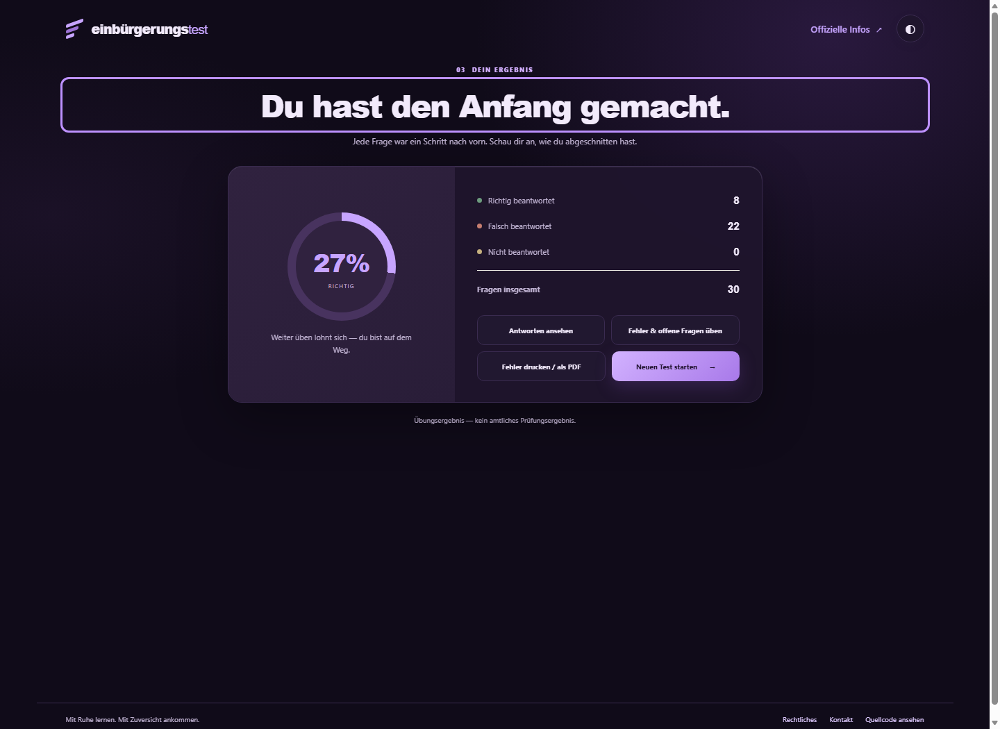

# einbürgerungstest · independent study app

Free, self-paced practice for the German citizenship test, with German-language learning activities from A1 to C1. The app is independent, works without an account, and can be installed as a progressive web app.

## Screenshots · Screenshots

The interface shown here is in German. Captions are in English and German.

| Desktop · Startseite | Mobile · Mobilansicht |
| --- | --- |
|  |  |
| Quiz · Übungsansicht | Results · Ergebnisauswertung |
|  |  |

## English

### What you can do

- Practice with 300 original question variants, topic rounds, and selectable round lengths.
- Take a 33-question, 60-minute practice simulation with three questions for a selected federal state. Questions are independently written, not official BAMF questions; the result is not an official exam result.
- Review answers and explanations, repeat missed questions, and print a review sheet.
- Use sample German modules from A1 to C1, with vocabulary, grammar, dictation, and browser speech synthesis.
- Optionally save per-question attempt and correct counters in this browser. Saving is off by default; answer text is never persisted.
- Use a voluntary, unscored reflection check-in. It is not a psychological assessment or crisis service.
- Install the PWA and use its cached app shell offline after the first visit.

### Legal, privacy, and contact

The [legal information page](legal.html) groups provider information, privacy details, local storage and offline-cache behavior, terms of use, accessibility notes, and contact. This is informational copy, not legal advice or a guarantee of compliance. **The operator must add and verify a complete postal address and any other required provider details before the page can be represented as a complete legal notice.** No address or company details have been invented.

The app has no account, app backend, analytics script, or advertising tracker. Quiz and reflection answers are held in page memory only. If enabled, `localStorage` stores only attempt/correct counts per question. The service worker caches same-origin app files for offline use. The hosting provider may process technical access logs under its own terms. Email links open the visitor's mail app and never send automatically.

The app is an independent study aid, is not affiliated with or endorsed by the BAMF, and does not provide legal, immigration, medical, or psychological advice.

Contact: [ruslanfridenli@proton.me](mailto:ruslanfridenli@proton.me)

### Run locally

No package installation is required. From the repository directory, start any static HTTP server, for example:

```bash
python -m http.server 8000
```

Then open `http://localhost:8000`.

### Tests and publishing

Run the question-data and application checks with Node.js:

```bash
node --test
```

The GitHub Actions workflow in `.github/workflows/pages.yml` publishes the static site to GitHub Pages when changes are pushed to `main`. Enable **Settings → Pages → GitHub Actions** in the repository.

## Deutsch

Kostenlose, unabhängige Übungswebsite für den Einbürgerungstest mit Deutsch-Lernbeispielen von A1 bis C1. Die Nutzung funktioniert ohne Konto; die Website kann als progressive Web-App installiert werden.

### Funktionen

- 300 selbst erstellte Fragevarianten, Themenrunden und wählbare Rundengrößen.
- Eine 33-Fragen-Übungssimulation mit 60 Minuten und drei Fragen zum gewählten Bundesland. Die Fragen sind keine amtlichen BAMF-Originalfragen; das Ergebnis ist kein amtliches Prüfungsergebnis.
- Antworten und Erklärungen ansehen, falsche Fragen wiederholen und einen Fehlerbericht drucken.
- Deutsch-Lernbeispiele von A1 bis C1 mit Wortschatz, Grammatik, Diktat und Browser-Sprachausgabe.
- Optionaler Lernzähler pro Frage im aktuellen Browser. Das Speichern ist standardmäßig ausgeschaltet; Antworttexte werden nicht dauerhaft gespeichert.
- Freiwilliger Check-in ohne Punktzahl. Er ist weder psychologische Diagnostik noch ein Krisenangebot.
- Installierbare PWA mit zwischengespeichertem App-Grundgerüst für die Offline-Nutzung nach dem ersten Besuch.

### Rechtliches, Datenschutz und Kontakt

Die zentrale [Seite mit rechtlichen Informationen](legal.html) bündelt Anbieterangaben, Datenschutz, lokale Speicherung und Offline-Cache, Nutzungsbedingungen, Hinweise zur Barrierefreiheit und Kontakt. Die Texte sind keine Rechtsberatung und garantieren keine Rechtskonformität. **Der Betreiber muss eine vollständige Postanschrift und alle sonst erforderlichen Anbieterangaben ergänzen und prüfen, bevor die Seite als vollständiges Impressum gelten kann.** Es wurden keine Anschrift und keine Unternehmensangaben erfunden.

Die Anwendung hat kein Konto, kein eigenes Backend, kein Analyse-Skript und keinen Werbetracker. Quiz- und Check-in-Antworten bleiben nur im Arbeitsspeicher der Seite. Wenn aktiviert, speichert `localStorage` ausschließlich Versuchs- und Richtig-Zähler pro Frage. Der Service Worker speichert gleich-originige App-Dateien für die Offline-Nutzung. Der Hosting-Anbieter kann nach seinen eigenen Bedingungen technische Zugriffsdaten verarbeiten. E-Mail-Links öffnen das Mailprogramm und versenden nichts automatisch.

Die Website ist eine unabhängige Lernhilfe, steht nicht mit dem BAMF in Verbindung und bietet keine Rechts-, Aufenthalts-, medizinische oder psychologische Beratung.

Kontakt: [ruslanfridenli@proton.me](mailto:ruslanfridenli@proton.me)

### Lokal starten

Es ist keine Paketinstallation nötig. Im Projektordner einen statischen HTTP-Server starten, zum Beispiel:

```bash
python -m http.server 8000
```

Danach `http://localhost:8000` öffnen.

### Tests und Veröffentlichung

Fragenkatalog und Anwendungsstruktur mit Node.js prüfen:

```bash
node --test
```

Der GitHub-Actions-Workflow unter `.github/workflows/pages.yml` veröffentlicht die statische Website nach einem Push auf `main` bei GitHub Pages. Dafür im Repository **Settings → Pages → GitHub Actions** als Quelle einstellen.
